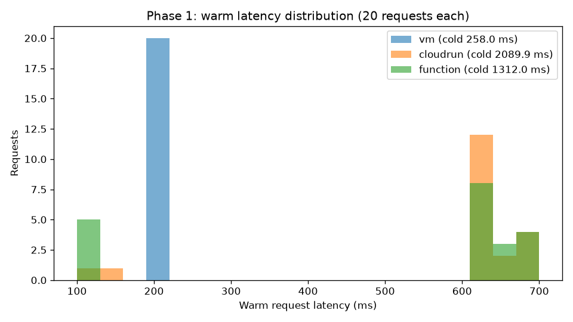

# Phase 1 — Comparison Report

Copy this file to `submission/phase1_report.md`, fill in every answer slot, and commit it:

```bash
cp phase-1-echo-bot/report_template.md submission/phase1_report.md
```

**How to fill it in.** Each answer sits between a pair of `<!--answer:...-->` markers. Replace
the `TODO` line with your answer — **leave the markers themselves untouched**, they are how the
grader finds your answers. Anything you write outside the markers is ignored, so add extra
prose, tables or images freely.

Numbers must **match `submission/phase1_report.json`** exactly — that file is produced by
`measure.py` and is what your figures are checked against. Copy them across; do not retype from
memory.

---

## 1. Setup facts

**Your image size**, in MB, from `gcloud artifacts docker images list` (number only, e.g. `142`):

<!--answer:image_size_mb-->
49
<!--/answer-->

**The custom VPC and subnet you created** (names only):

<!--answer:vpc_name-->
echo-net
<!--/answer-->

<!--answer:subnet_name-->
echo-subnet
<!--/answer-->

---

## 2. Measurements

Copy these from `submission/phase1_report.json`. Cold is `cold_ms`; warm median is
`stats.median`. Numbers only, in milliseconds (e.g. `812.4`).

| Platform | Cold (ms) | Warm median (ms) |
|---|---|---|
| IaaS VM | <!--answer:vm_cold_ms-->258.0<!--/answer--> | <!--answer:vm_warm_median_ms-->211.6<!--/answer--> |
| Cloud Run | <!--answer:cloudrun_cold_ms-->2089.9<!--/answer--> | <!--answer:cloudrun_warm_median_ms-->636.1<!--/answer--> |
| Cloud Function | <!--answer:function_cold_ms-->1312.0<!--/answer--> | <!--answer:function_warm_median_ms-->636.5<!--/answer--> |

Include your histogram or plot of the warm distribution below (an image, or the ASCII chart
`measure.py` prints). This is read by a human, not the grader:

<!--answer:latency_plot-->

<!--/answer-->

---

## 3. Per-platform analysis

**Scaling behaviour.** Imagine requests arriving one at a time, then ten at once, then a
hundred. For each of the three platforms, answer concretely:

- Does anything get created automatically to absorb the load — and if so, *what* exactly?
  (One platform here creates nothing at all.)
- What is the hard limit, and where does it come from — a flag you passed yourself, or the
  size of the machine you picked?

(~80 words. Your `--machine-type=e2-micro` and `--max-instances=3` are both concrete answers
to the second question.)

<!--answer:scaling_behaviour-->
The VM creates nothing new. It’s one e2-micro running one container, so under heavy load extra requests just queue or time out, and the limit is the machine size I picked. Cloud Run starts new container instances automatically, up to 80 requests each, capped at 3 by my --max-instances=3. The function also scales out automatically, but at one request per instance, up to the default limit of 100.
<!--/answer-->

**Deployment effort.** What did you have to build, configure and maintain to get each of the
three running? (~100 words)

<!--answer:deployment_effort-->
The VM took the most work. I built the VPC, subnet and firewall rules, created the VM, gave it pull access, then SSH’d in to install Docker and start the container, and patching it stays my job. Cloud Run needed a Dockerfile and a pushed image, then one deploy command, and Google handles scaling and HTTPS. The function was easiest: one deploy straight from source, no Dockerfile or registry, but also the least control.
<!--/answer-->

---

## 4. Why do two of your three numbers look alike?

With Cloud Run and your Function both deployed, run `gcloud run services list` and paste the
**complete output** here, unedited:

<!--answer:run_services_list-->
✔
SERVICE: echo
REGION: us-central1
URL: https://echo-241259896632.us-central1.run.app
LAST DEPLOYED BY: service-241259896632@gcf-admin-robot.iam.gserviceaccount.com
LAST DEPLOYED AT: 2026-10-24T10:01:45.028016Z

✔
SERVICE: echo-bot
REGION: us-central1
URL: https://echo-bot-241259896632.us-central1.run.app
LAST DEPLOYED BY: Ketaki.Chavan@eurecom.fr
LAST DEPLOYED AT: 2026-10-24T09:59:40.615442Z
<!--/answer-->

Now explain what that output tells you about how your Function is actually being run, why its
cold start resembles Cloud Run's so closely, and what — if anything — genuinely differs between
the two deployment paths. (~120 words)

<!--answer:convergence_explanation-->
The list shows my function echo as a Cloud Run service next to echo-bot. It was deployed by Google’s gcf-admin-robot, not by me, and its URL ends in .run.app. So a gen-2 function is Cloud Run underneath: Google built a container from my source and deployed it to Cloud Run. Both cold-start the same way, by starting a fresh container, which is why their warm medians are almost identical (636.1 vs 636.5 ms) and both cold starts sit far above the VM's. The real differences are packaging (my Dockerfile versus Google’s generated image), resources (0.17 vCPU and 256 MB versus 1 vCPU and 512 MB) and concurrency (1 versus 80).
<!--/answer-->
